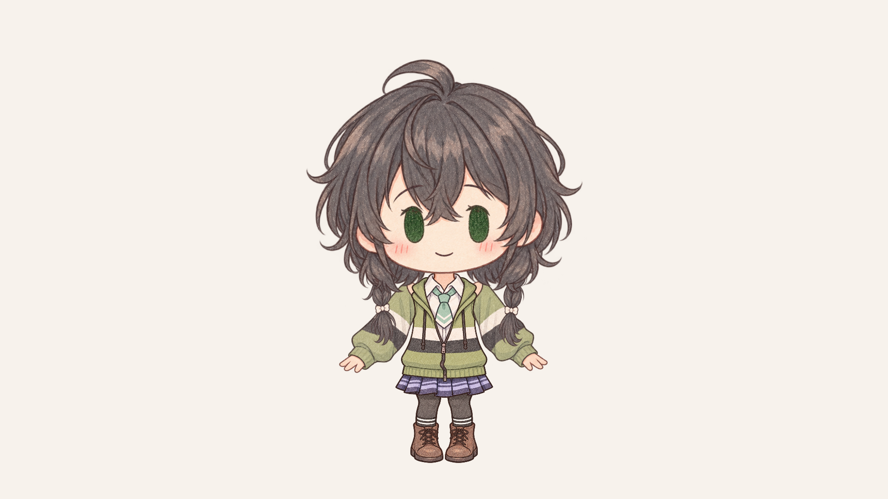

# Chifuyu Chibi Model for Halfne Miku Studio Reborn

花隈千冬的铅笔 Q 版非官方模型，版本 **1.0.0**。独立的两条袖臂、随头运动的眉眼和嘴、双辫轻摆、自动眨眼、三种表情、四种嘴型。适用于小初音工作室 Reborn。



## 导入

1. 打开 [小初音工作室 Reborn](https://github.com/yuyuyzl/halfne-miku-studio-reborn)。
2. 在 Settings / 设置中选择导入模型，选择 `model/Chifuyu-Chibi-HMSR.js`。
3. JS 已包含全部 14 张 PNG，不用逐张导入，不依赖外部图片地址。
4. 在 Timeline / 时间轴中导入 `examples/demo-controls-6s.json`，播放 6 秒表情和摆头、双臂动作演示。演示无音乐，口型是合成控制数据。
5. 暂停时间轴后可使用下列键位。演示结束后如要恢复默认慢摆，清空演示轨道并重新导入模型。

| 键位 | 动作 |
| --- | --- |
| `1` | 温和表情 |
| `2` | 若有所思 |
| `3` | 笑眼 |
| `X` | 按住闭眼 |
| `S` | 小开口 |
| `D` | 中开口 |
| `A` / `W` | 大开口 |

表情保留到下一次切换，口型键松开后闭口。声音控制可以由自制时间轴传入 `audioEnergy`（0–1），或直接传入 `mouthOpen` / `mouthOverride`。**模型本身不分析导入音乐，不自动识别歌词或音素。** Studio 没有给模型传入声量时，请录制口型键，或从外部声量分析生成时间轴。包中不包含任何声库、翻唱、原曲或广播剧音轨。

## 本次修复

原躯干素材内画有两条静态袖臂，叠加活动袖臂后产生多手观感。新版躯干已通过图像编辑重新生成为**无臂躯干**；渲染中仅有 `arm_left` 与 `arm_right` 两个手臂节点。旧的含袖躯干不在本包，也不会参与绘制。

眉毛和眼睛是同一表情图层，口型和双辫均挂在头部坐标系；头部运动不分别扭曲脸部。默认轻摆约 ±7.3°，演示测试覆盖头部 ±12°、双臂 ±16°。这是二维分层元件模型，不是 Cubism `.moc3` 格式。

## 源码与复现

构建需要 Python 3.9+，构建脚本无第三方依赖：

```sh
python scripts/build.py
python scripts/build.py --verify
node --check model/Chifuyu-Chibi-HMSR.js
```

- `source/assets/`：14 张透明 PNG。
- `source/model-config.json`：纹理与锚点配置。
- `source/runtime.js`：未嵌入资源的原生模型脚本。
- `scripts/verify_native.mjs`：原生导入与逐帧解析测试；需向脚本传入上游 `modelUtils.mjs` / `core.mjs` 所在目录。若从源码 `.js` 复制为 `.mjs`，仅需相应调整 `core` 的 import 后缀。
- `scripts/render_native_preview.py`：用已解析原生几何生成预览；需 Python `numpy`、`opencv-python` 及 FFmpeg。
- `qa/native_import_motion.json`：本次实际测试结果与运行时 SHA256。

实际用上游 `parseModelJS` 和 `core.work` 完成 360 帧解析，验证三种表情、四种嘴型、手动口型释放、声量/静音控制、仅两条手臂与有限几何数值。预览由解析后的真实节点几何合成。**没有声称完成浏览器界面的现场导入测试。** 模型规范来源见 [上游文档](https://github.com/yuyuyzl/halfne-miku-studio-reborn/blob/master/model-docs.md)。

## 发布

将本目录作为仓库内容上传，Release 附件可放 `model/Chifuyu-Chibi-HMSR.js` 和完整 ZIP。不要将本次歌曲或广播剧工程上传到此模型仓库。可直接使用 `RELEASE_NOTES.md` 作为首次发布说明。

素材由 AI 辅助生成、编辑；角色相关权利仍归各原权利人所有。包内许可说明见 `LICENSE_NOTICE.md`，素材来源说明见 `CREDITS.md`。本包不是官方模型，也不包含声库产品。

## English

An unofficial pencil chibi Hanakuma Chifuyu model for Halfne Miku Studio Reborn. Import the self-contained JS file. Four mouth shapes, three expressions, blinks, rigid head-attached face features and independently moving braids/arms are included. The torso has no baked-in arms; only two arm sprites are drawn. The model accepts external amplitude/timeline controls but does not transcribe or analyze imported music. See the notices for character rights and AI-assisted image provenance.
